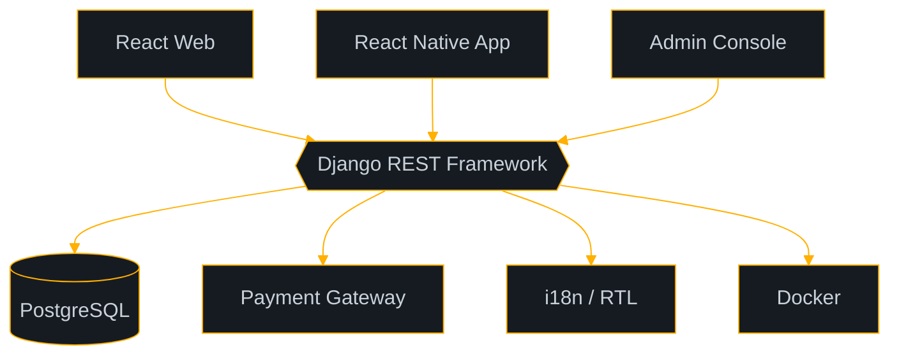

 

 

<table>
<tr>
<td width="57%" valign="top">

### About

I studied Computer Engineering at Amirkabir University of Technology, and most of
what I build ends up in front of real users: booking flows, payments, passenger
records, mobile apps.

The backend is where I'm most comfortable, usually Django and DRF over
PostgreSQL, with React or React Native on the front. I also work with machine
learning, and I'm most interested in NLP and recommendation systems.

</td>
<td width="43%" valign="top">

### At a glance

**Education**
B.Sc. Computer Engineering, AUT

**Core stack**
Django · DRF · React · PostgreSQL

**Learning now**
Retrieval augmented generation, vector search, Persian NLP

**Status**
Open to work and collaboration

</td>
</tr>
</table>

---

## Projects

| # | Project | What it is | Stack | Status |
|:--|:--|:--|:--|:--|
| 01 | **[Sharifineya Travel Platform](https://www.sharifineyatrip.com/)** | Travel and transport system: web, admin, booking, payments | Django, DRF, React, PostgreSQL | `Live` |
| 02 | **[Sharifineya Mobile](https://play.google.com/store/apps/details?id=com.sharifineya.mobile)** | Android app for searching and booking trips | React Native, Expo | `Google Play` |
| 03 | **Urban Helper** | Civic platform for reporting and tracking city issues | Django, React, PostgreSQL | `Completed` |
| 04 | **[Pahlawan](https://pahlawan-ai.netlify.app/)** | AI workout planner with personalized training plans | Python, Django, React | `Active` |
| 05 | **[Portfolio](https://yaserzarifi.vercel.app/en)** | Personal site for projects and experience | Next.js, React, Tailwind | `Live` |

 

<b>01 &nbsp; Sharifineya Travel Platform</b> &nbsp; <code>production</code>

 

The travel and transportation system I built for Sharifineya Travel Services. It
covers the customer website, the admin panel, booking, passenger management,
payments, and multiple languages. One REST API serves both the web app and the
mobile app.

**[sharifineyatrip.com](https://www.sharifineyatrip.com/)**

<b>02 &nbsp; Sharifineya Mobile</b> &nbsp; <code>android</code>

 

An Android app published on Google Play. Users can search for trips, book them,
and enter passenger details, and all of it talks to the same Django backend as
the website.

**[Download on Google Play](https://play.google.com/store/apps/details?id=com.sharifineya.mobile)**

<b>03 &nbsp; Urban Helper</b> &nbsp; <code>university project</code>

 

My final project at AUT. Citizens can report city problems and follow what
happens to them, so requests don't get lost between the people who file them and
the services that handle them.

<b>04 &nbsp; Pahlawan, AI Workout Planner</b> &nbsp; <code>ai</code>

 

A fitness app that builds personalized workout plans and helps users keep their
training organized. The hard part was keeping the generated plans realistic
enough that people would actually stick to them.

<b>05 &nbsp; Portfolio</b> &nbsp; <code>personal site</code>

 

My projects and experience in one place.

**[yaserzarifi.vercel.app](https://yaserzarifi.vercel.app)**

---

## Tech Stack

| Layer | | Tools |
|:--|:--|:--|
| **Backend** |  | Python, Django, Django REST Framework, PostgreSQL, REST API design |
| **Frontend** |  | React, Next.js, JavaScript, Tailwind CSS, Bootstrap, HTML, CSS |
| **Mobile** |  | React Native, Expo |
| **AI and Data** |  | TensorFlow, PyTorch, NumPy, Pandas |
| **Infra and Tools** |  | Docker, Git, GitHub, Linux, Vercel |
| **Also** |  | Java, C |

---

## How I Work

| | |
|:--|:--|
| **Schema first** | I design the data model before writing endpoints. |
| **API before UI** | The contract gets agreed on before anything is styled. |
| **Reproducible** | Docker, so it runs the same on every machine. |
| **Multilingual early** | Languages and RTL are handled from the start, not patched in. |
| **Shipped** | Deployed and kept running, not left on localhost. |

**Interested in:** AI and machine learning, NLP, search and recommendation systems, database systems, cloud deployment, UX engineering.

---

## Activity

---

## Contact

| | |
|:--|:--|
| **Email** | [yaserzarifi1378@gmail.com](mailto:yaserzarifi1378@gmail.com) |
| **LinkedIn** | [mohammad-yaser-zarifi](https://www.linkedin.com/in/mohammad-yaser-zarifi/) |
| **Portfolio** | [yaserzarifi.vercel.app](https://yaserzarifi.vercel.app/en) |
| **Google Play** | [Sharifineya Mobile](https://play.google.com/store/apps/details?id=com.sharifineya.mobile) |

Open to full-stack and AI engineering roles, freelance work, and collaborations.

