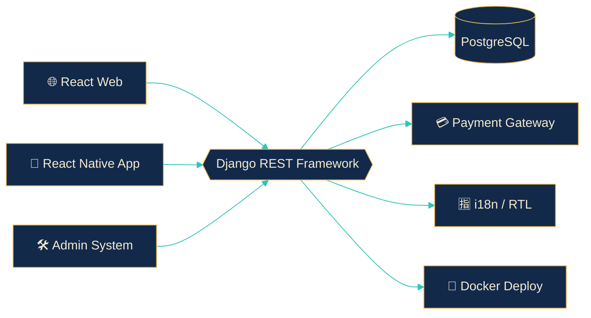

<!--
  ╔═══════════════════════════════════════════════════════════════════╗
  ║  Girih palette                                                    ║
  ║    Lapis     #0B1B34    Persian Blue #1C39BB                      ║
  ║    Turquoise #2EC4B6    Saffron      #E9B44C                      ║
  ║    Terracotta#C1440E    Cream        #F4EBD0                      ║
  ╚═══════════════════════════════════════════════════════════════════╝
-->

 

**`۞ ◈ ✦ ◈ ۞ ◈ ✦ ◈ ۞ ◈ ✦ ◈ ۞ ◈ ✦ ◈ ۞`**

---

## ۞ &nbsp;About Me &nbsp;</samp>

> *"The best way to predict the future is to build it."*

**Computer Engineering graduate — Amirkabir University of Technology (AUT).**

I build software that real people log into. My work sits where solid backend engineering, careful interface design, and applied machine learning meet — the kind of engineering where a booking either goes through or it doesn't, and the API had better be honest about which.

<table>
<tr>
<td width="50%" valign="top">

**◈ &nbsp;What I build**

- Full-stack platforms — Django · DRF · React · PostgreSQL
- Cross-platform mobile — React Native · Expo
- Applied AI / ML and NLP features
- API design, architecture, scalable deployment

</td>
<td width="50%" valign="top">

**◈ &nbsp;How I build it**

- Production-first: shipped, used, maintained
- REST contracts before UI guesswork
- Dockerized, reproducible environments
- Multilingual and RTL-aware from day one

</td>
</tr>
</table>

---

## ✦ &nbsp;Engineering Focus &nbsp;</samp>

### ⬢ &nbsp;Sharifineya Travel Platform &nbsp;

A complete travel & transportation ecosystem built for Sharifineya Travel Services — customer web platform, admin management system, booking workflows, passenger management, payment integration, multilingual support, and the REST API that also feeds the mobile app.

 

### ⬡ &nbsp;Sharifineya Mobile App &nbsp;

A published Android application delivering the transportation service as a mobile-first experience: trip search, booking flows, passenger information management, and live backend communication.

**[▸ Install from Google Play](https://play.google.com/store/apps/details?id=com.sharifineya.mobile)**

 

### ⬢ &nbsp;Urban Helper &nbsp;

A civic assistance platform from my final year at AUT, built to close the gap between citizens and urban service providers — turning scattered municipal complaints into a trackable digital workflow.

 

### ⬡ &nbsp;Pahlawan — AI Workout Planner &nbsp;

An AI-powered fitness companion that generates personalized training plans and keeps a user's whole journey organized — recommendations that adapt to the person instead of handing everyone the same spreadsheet.

 

### ⬢ &nbsp;Personal Portfolio

My developer portfolio — projects, skills, and engineering experience in one place.
**[▸ yaserzarifi.vercel.app](https://yaserzarifi.vercel.app)**

---

## ◈ &nbsp;Tech Stack &nbsp;</samp>

|  ✦ Frontend  |  ✦ Backend  |  ✦ AI & Data  |  ✦ Infra & Tools  |
| :---: | :---: | :---: | :---: |
|   |  |    |   |

---

## ✦ &nbsp;Areas of Interest

`◆ Artificial Intelligence & Machine Learning` &nbsp; `◇ Natural Language Processing`

`◆ Search & Recommendation Systems` &nbsp; `◇ Software Engineering`

`◆ Database Systems` &nbsp; `◇ Cloud Deployment` &nbsp; `◆ UX Engineering`

<b>۞ &nbsp;A little more, if you're curious</b>

 

- **Reading toward:** retrieval-augmented systems, vector search, and Persian-language NLP — a language whose morphology punishes lazy tokenizers.
- **Comfort zone:** taking a vague product idea, drawing the data model, and having a working API by the end of the week.
- **Long game:** software that serves the city it's built in — civic tech, transport, accessibility.
- **Non-negotiable:** if it isn't deployed, it isn't done.

---

## ۞ &nbsp;GitHub Analytics

  

  

 

---

## ◈ &nbsp;Let's Build Something

Open to collaboration, freelance work, and roles in **full-stack** or **AI-driven** product engineering.

  

 

**`۞ ◈ ✦ ◈ ۞ ◈ ✦ ◈ ۞ ◈ ✦ ◈ ۞ ◈ ✦ ◈ ۞`**

*Always learning. Always building.* &nbsp;·&nbsp; <samp>همیشه در حال ساختن</samp>

<!--
  ── Optional upgrades ─────────────────────────────────────────────
  1) Pinned project cards (swap in your real repo names):
     

  2) Animated contribution snake — add .github/workflows/snake.yml
     (Platane/snk action), then embed the generated SVG here.

  3) WakaTime coding-time card, if you use WakaTime:
     
  ──────────────────────────────────────────────────────────────────
-->
