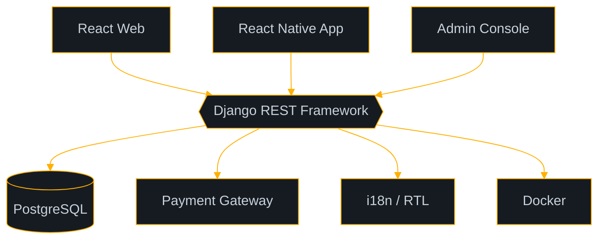

 

 

<table>
<tr>
<td width="57%" valign="top">

### About

I'm a Computer Engineering graduate from Amirkabir University of Technology, focused on building software that solves real-world problems.

My work spans full-stack web development, mobile applications, backend architecture, and cloud deployment. I've built production systems for travel booking and payments and contributed as a volunteer full-stack developer to DATAAFG, an open-access academic research repository for Afghanistan.

I'm most comfortable with Django, DRF, PostgreSQL, and React. I also work with Linux infrastructure, Docker, CI/CD automation, and applied machine learning.

</td>
<td width="43%" valign="top">

### At a glance

**Education**  
B.Sc. Computer Engineering, AUT

**Core stack**  
Django · DRF · React · PostgreSQL

**Engineering**  
Full-stack · Cloud · CI/CD

**Learning now**  
RAG, vector search, Persian NLP

**Status**  
Open to work and collaboration

</td>
</tr>
</table>

---

## Projects

| # | Project | What it is | Stack / Focus | Status |
|:--|:--|:--|:--|:--|
| 01 | **[Sharifineya Travel Platform](https://www.sharifineyatrip.com/)** | Travel and transport system: web, admin, booking, payments | Django, DRF, React, PostgreSQL | `Live` |
| 02 | **[Sharifineya Mobile](https://play.google.com/store/apps/details?id=com.sharifineya.mobile)** | Android app for searching and booking trips | React Native, Expo | `Google Play` |
| 03 | **[DATAAFG](https://dataafg.com/)** | Open-access repository preserving Afghanistan's academic research | Full-stack, Linux, CI/CD | `Live · Volunteer` |
| 04 | **Urban Helper** | Civic platform for reporting and tracking city issues | Django, React, PostgreSQL | `Completed` |
| 05 | **[Pahlawan](https://pahlawan-ai.netlify.app/)** | AI workout planner with personalized training plans | Python, Django, React | `Active` |
| 06 | **[Portfolio](https://yaserzarifi.vercel.app/en)** | Personal site for projects and experience | Next.js, React, Tailwind | `Live` |

 

<b>01 &nbsp; Sharifineya Travel Platform</b> &nbsp; <code>production</code>

 

The travel and transportation system I built for Sharifineya Travel Services. It covers the customer website, the admin panel, booking, passenger management, payments, and multiple languages. One REST API serves both the web app and the mobile app.

**[sharifineyatrip.com](https://www.sharifineyatrip.com/)**

<b>02 &nbsp; Sharifineya Mobile</b> &nbsp; <code>android</code>

 

An Android app published on Google Play. Users can search for trips, book them, and enter passenger details, and all of it talks to the same Django backend as the website.

**[Download on Google Play](https://play.google.com/store/apps/details?id=com.sharifineya.mobile)**

<b>03 &nbsp; DATAAFG, Afghanistan Academic and Research Repository</b> &nbsp; <code>volunteer · production</code>

 

**[DATAAFG](https://dataafg.com/)** is an independent, non-profit, open-access academic repository dedicated to preserving, organizing, indexing, and sharing the scholarly work of Afghan researchers.

Founded around the motto **"How does Afghanistan think?"**, the initiative addresses the fragmentation and loss of Afghanistan's academic and research output by making scholarly knowledge more accessible, discoverable, and easier to preserve.

The repository supports the long-term vision of strengthening Afghanistan's academic infrastructure and connecting researchers, students, universities, and the international scholarly community.

### My contribution

**Volunteer Full-Stack Developer**

Contributed to the platform's complete software delivery lifecycle, from application development and frontend/backend implementation to production deployment, Linux server management, and CI/CD automation.

**Engineering responsibilities:**

- **Full-stack development:** Developed and maintained frontend and backend application functionality.
- **Authentication and sessions:** Worked on login verification, user sessions, and session history management.
- **Research workflows:** Contributed to document uploads, upload progress handling, and metadata presentation.
- **User experience:** Improved responsive navigation, account controls, and multilingual interface elements.
- **Cloud infrastructure:** Deployed and maintained the production application on a Hetzner-hosted Ubuntu server.
- **CI/CD automation:** Configured and maintained GitHub Actions deployment workflows, automating updates from the repository to production.
- **Operations:** Managed Git workflows, deployment troubleshooting, and production application updates.

**[Visit the live platform](https://dataafg.com/)**

<b>04 &nbsp; Urban Helper</b> &nbsp; <code>university project</code>

 

My final project at AUT. Citizens can report city problems and follow what happens to them, so requests don't get lost between the people who file them and the services that handle them.

<b>05 &nbsp; Pahlawan, AI Workout Planner</b> &nbsp; <code>ai</code>

 

A fitness app that builds personalized workout plans and helps users keep their training organized. The hard part was keeping the generated plans realistic enough that people would actually stick to them.

<b>06 &nbsp; Portfolio</b> &nbsp; <code>personal site</code>

 

My projects and experience in one place.

**[yaserzarifi.vercel.app](https://yaserzarifi.vercel.app)**

---

## Volunteer Experience

### Full-Stack Developer | DATAAFG

**Afghanistan Academic and Research Repository**  
`Volunteer` · `Full-stack Engineering` · `Cloud & DevOps`

**[dataafg.com](https://dataafg.com/)**

Supporting the development and operation of an independent, non-profit academic repository designed to preserve Afghanistan's scholarly heritage and provide free access to research.

My work involves delivering software across the entire application lifecycle:

| Area | Responsibilities |
|:--|:--|
| **Application Development** | Frontend and backend implementation, feature development, and maintenance |
| **Authentication** | Login verification, session handling, and user account functionality |
| **Research Platform** | Document uploads, metadata presentation, and contributor-facing workflows |
| **UI/UX** | Responsive interfaces, navigation improvements, and multilingual UI |
| **Infrastructure** | Linux server configuration, cloud deployment, and production maintenance |
| **CI/CD** | GitHub Actions workflows, deployment automation, and troubleshooting |

This experience combines hands-on software engineering with a broader mission to improve access to academic knowledge and strengthen Afghanistan's digital research infrastructure.

---

## Tech Stack

| Layer | | Tools |
|:--|:--|:--|
| **Backend** |  | Python, Django, Django REST Framework, PostgreSQL, REST API design |
| **Frontend** |  | React, Next.js, JavaScript, Tailwind CSS, Bootstrap, HTML, CSS |
| **Mobile** |  | React Native, Expo |
| **AI and Data** |  | TensorFlow, PyTorch, NumPy, Pandas |
| **Infra and DevOps** |  | Docker, Git, GitHub, GitHub Actions, CI/CD, Linux, Hetzner Cloud, Vercel |
| **Also** |  | Java, C |

---

## How I Work

| | |
|:--|:--|
| **Schema first** | I design the data model before writing endpoints. |
| **API before UI** | The contract gets agreed on before anything is styled. |
| **Reproducible** | Docker, so it runs the same on every machine. |
| **Multilingual early** | Languages and RTL are handled from the start, not patched in. |
| **Automated delivery** | CI/CD workflows make production deployments consistent and repeatable. |
| **Shipped** | Deployed and kept running, not left on localhost. |

**Interested in:** AI and machine learning, NLP, search and recommendation systems, database systems, cloud infrastructure, DevOps, digital public infrastructure, and UX engineering.

---

## Activity

---

## Contact

| | |
|:--|:--|
| **Email** | [yaserzarifi1378@gmail.com](mailto:yaserzarifi1378@gmail.com) |
| **LinkedIn** | [mohammad-yaser-zarifi](https://www.linkedin.com/in/mohammad-yaser-zarifi/) |
| **Portfolio** | [yaserzarifi.vercel.app](https://yaserzarifi.vercel.app/en) |
| **Google Play** | [Sharifineya Mobile](https://play.google.com/store/apps/details?id=com.sharifineya.mobile) |

Open to full-stack and AI engineering roles, freelance work, and collaborations.

